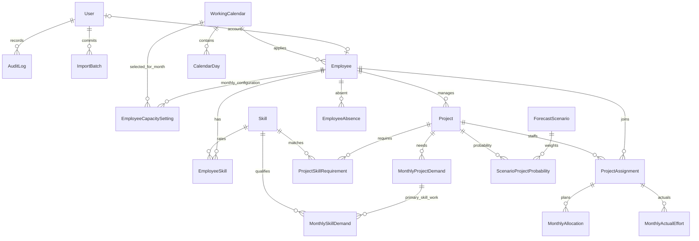

# DX Service – IT-RMS: thiết kế trước triển khai

## Kiến trúc và phạm vi
Modular monolith Next.js App Router, TypeScript strict; React server components đọc PostgreSQL qua Prisma, client components cho filter và Recharts. Route handlers xử lý ghi, Zod kiểm tra đầu vào, session cookie HttpOnly + JWT có hạn sử dụng, kiểm tra role và user hiện hành ở server. Không dùng localStorage để lưu nhân sự. Tailwind 4, shadcn/ui Button (CVA + Radix Slot), navy/white/orange.

`src/app/(workspace)/`: dashboard, employees, employees/[id], projects. `src/app/api/`: auth và mutations. `src/components/`: shell, charts, tables, UI. `src/lib/`: auth, database, validation, services, MM. `prisma/`: schema, migration, seed. `tests/`: unit và integration. `docs/`: kiến trúc, quyết định nghiệp vụ.

Phase 1: nền tảng, toàn bộ schema, đăng nhập/đăng xuất, 3 role ADMIN/MANAGER/VIEWER, tạo/sửa/xem/tìm/lọc nhân viên và dự án, dashboard cơ bản, audit transaction. Các module khác có trang thông báo phase và không hiển thị số forecast giả. Không triển khai toàn bộ chức năng các phase sau.

## ERD

## Quy tắc
- Tháng lưu ngày đầu tháng (DATE), hỗ trợ nhiều năm; unique assignment+month, employee+project, employee+skill, project+skill, calendar+date. SQL CHECK bảo vệ MM >= 0, proficiency 1–5, level 1–6, tỷ lệ 0–1, ngày kết thúc >= bắt đầu.
- Capacity tháng = tổng ngày làm việc khả dụng sau lễ, phép, ngày không khả dụng, giới hạn ngày vào/nghỉ việc × tỷ lệ tham gia / ngày công chuẩn. Ngày công chuẩn > 0 được cấu hình theo lịch/tháng. Ngày lịch có workingFraction 0–1; absence cùng ngày được tổng hợp và chặn ở workingFraction để không trừ hai lần. Các ngày chưa có lịch không được tự giả định là ngày làm việc.
- Capacity, Allocation, Actual, Demand khác nhau; không suy Actual từ Planned. Allocated = tổng allocation, Available = Capacity − Allocated (có thể âm), Utilization = Allocated/Capacity. Capacity 0 → utilization null, allocated > 0 vẫn cảnh báo. MM lưu Decimal(12,4), cộng trước rồi làm tròn hiển thị 2 số theo half-up. Công thức unit test riêng; lịch và matrix triển khai Phase 2.
- Nhân viên nghỉ việc vẫn giữ lịch sử, capacity tương lai sau ngày nghỉ = 0. Archive/đổi trạng thái thay vì xóa nhân viên và dự án đã tham gia. FK RESTRICT ngăn mất lịch sử. Sửa dữ liệu và audit chạy cùng transaction; AuditLog lưu before/after, không ghi mật khẩu hay session.
- Pipeline Demand độc lập Confirmed Demand. Phase 4: weighted pipeline chỉ tính khi scenario có xác suất project rõ ràng; scenario thiếu xác suất phải báo thiếu dữ liệu. Resource Gap = Supply − Confirmed − Weighted Pipeline; âm là thiếu. Conservative/Base/Optimistic phải cấu hình xác suất, không tự gộp pipeline.
- ADMIN và MANAGER được sửa nhân viên/dự án; VIEWER chỉ đọc. Quản lý tài khoản dành ADMIN ở phase sau. Không có đăng ký công khai, seed tạo tài khoản demo. Cookie SameSite=Lax, HttpOnly, Secure trong production; mutation kiểm tra Origin và role ở server; đăng nhập giới hạn số lần bằng bộ nhớ tiến trình (cần distributed store trước production).
- Dashboard Phase 1 chỉ có headcount, portfolio và capacity/allocation từ dữ liệu thực có. Chưa có lịch thì capacity hiển thị chưa thiết lập, không giả định headcount = MM. Bộ lọc tháng/vai trò/địa điểm/dự án được áp dụng cho thống kê.

## Kế hoạch
1. Foundation: scaffold → schema/migration/seed → auth/RBAC → CRUD và dashboard → test/build/docs.
2. Resource Planning: UI lịch, absence, capacity engine theo dữ liệu lịch, allocation matrix, planned/actual, audit.
3. Capability: skill matrix, tìm tổ hợp kỹ năng, requirements.
4. Forecast: demand tháng, kịch bản có xác suất, skill gap, đề xuất điều chuyển/tuyển.
5. Reporting: Excel import có preview/validation/transaction, export, audit UI, E2E, observability, backup, security hardening.

Migration được quản lý bằng Prisma; không dùng db push thay thế migration. Seed chỉ dùng danh tính giả @example.test, 30 nhân viên và 8 dự án, không chạy tự động trong production.

## Cập nhật Phase 2

Đã triển khai Resource Planning; xem [thiết kế chi tiết](phase-2-design.md). Bổ sung EmployeeCapacitySetting theo nhân viên/tháng và version kiểm soát sửa đồng thời cho lịch tháng, capacity setting, absence, planned và actual. Nghỉ đã hủy giữ fraction=0/version mới. Capacity engine dùng chung cho Planning, Dashboard và Employee Detail; capacity không lưu aggregate. Các quyết định Phase 1 phía trên là bối cảnh thiết kế ban đầu; phạm vi hiện tại và kiểm thử ghi trong [báo cáo Phase 2](phase-2-report.md).

## Cập nhật Phase 3

Đã triển khai Capability Management; xem [thiết kế chi tiết](phase-3-design.md). Skill/EmployeeSkill/ProjectSkillRequirement có active/version, soft-remove và audit; catalog có unique tên không phân biệt hoa/thường. Skill Matrix và Resource Search dùng hồ sơ kỹ năng hiện tại, kết hợp supply/capacity theo tháng của Phase 2. Requirement dự án luôn dùng AND, không biến requiredMm thành demand tháng hoặc cộng qua kỹ năng. [Báo cáo Phase 3](phase-3-report.md) ghi kết quả và giới hạn hiện tại.

## Cập nhật Phase 4

Đã triển khai Resource Forecast v0.4.0; xem [thiết kế chi tiết](phase-4-design.md) và [báo cáo kiểm thử/bàn giao](phase-4-report.md). `forecast-validation`, `forecast-service`, `forecast-data`, `forecast-engine` tách validation, ghi transaction, đọc dữ liệu và tính toán thuần; `max-flow` phân phối MM mà không đếm trùng ngân sách nhân viên. `/forecast` có tổng quan, demand và xác suất; Dashboard dùng cùng engine và thêm đủ 5 biểu đồ quản trị nguồn lực.

MonthlyProjectDemand có version và các MonthlySkillDemand theo khóa demandId/skillId; mỗi dòng là một phần công việc không chồng MM. Deferred constraint trigger kiểm tra tổng MM kỹ năng không vượt demand trong trạng thái cuối transaction, khóa bản ghi cha để tránh xung đột. ForecastScenario unique theo kind; ScenarioProjectProbability nullable/version giữ khác biệt giữa chưa nhập và 0, kể cả sau khi xóa xác suất. Service kiểm tra thứ tự Conservative ≤ Base ≤ Optimistic giữa các giá trị đã nhập, row lock, quyền và audit cùng transaction.

Capacity, Allocation, Actual và Demand vẫn độc lập. Thiếu đầu vào cho tổng nào thì tổng đó chưa xác định. Confirmed không chứa Pipeline; chỉ Weighted Pipeline theo xác suất tường minh được cộng vào Expected Demand. Resource Gap = Supply − Expected Demand. Max-flow tính thiếu hụt năng lực sau điều phối toàn bộ supply và gợi ý riêng từ MM đang rảnh sau cam kết; gợi ý không ghi allocation. Mô hình theo tháng, chưa tối ưu lịch ngày hoặc lưu snapshot forecast bất biến. Phase 5 tiếp tục reporting/Excel, audit UI và production readiness.

## Cập nhật Phase 5

Đã triển khai Reporting/Excel và các công cụ chuẩn bị production v0.5.0; xem [thiết kế](phase-5-design.md), [báo cáo](phase-5-report.md) và [runbook](production-runbook.md). `excel.ts` kiểm tra ZIP/XLSX, template và export có kiểu; `import-service.ts` quản lý preview ký số/fingerprint/actor/hạn dùng và commit Serializable toàn file. `reporting.ts` dùng lại engine planning/forecast cho báo cáo, phân trang audit và lọc thông tin nhạy cảm. API `/api/reports/[action]` kiểm tra quyền/Origin và giới hạn body trước khi đọc vào bộ nhớ.

Migration thứ sáu thêm ImportBatch (idempotency), LoginThrottle (counter atomic dùng chung nhiều process), User.sessionVersion và index thời gian/actor cho AuditLog. Không lưu tổng MM hoặc file/token import. Ngăn ghi đè bằng kiểm tra lại fingerprint trong transaction; serialization conflict trả 409, cần preview lại. Planned/Actual import gọi cùng service transaction như Allocation Matrix.

`/reports` và `/audit` là trang nghiệp vụ thật; VIEWER không xem audit/không import. Dashboard và các module Phase 1–4 giữ nguyên mô hình nghiệp vụ. Local dev/build dùng Webpack do lỗi subprocess CSS Turbopack trên Windows đã quan sát; Next standalone phục vụ production/Docker. Workflow CI, preflight, health, backup/restore và revoke CLI đã có mã; Docker/CI remote, quyền hạ tầng và restore drill cần kiểm chứng riêng trước production.
