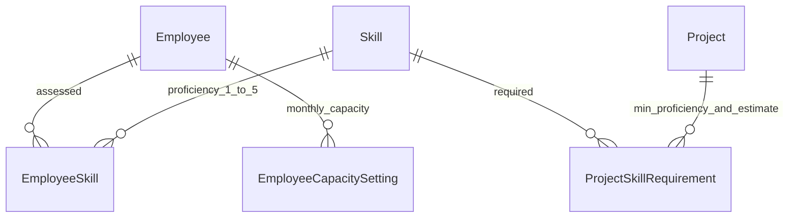

# Phase 3 – Capability Management

## Kiến trúc và thứ tự

Giữ modular monolith hiện có. Bổ sung `src/lib/capability-*` cho schema/API/service, DTO và thuật toán tìm kiếm thuần; `src/components/capabilities/` cho Skill Matrix, catalog, search và project requirements. Trang `/skills` có ba tab Matrix, Tìm nhân sự và Danh mục; `/projects/[id]` có thông tin và yêu cầu kỹ năng. Tận dụng capacity engine Phase 2 theo tháng; không tạo công thức supply thứ hai.

Thực hiện migration → service có audit/concurrency → matrix và catalog → tìm kiếm → yêu cầu dự án → seed/test/docs.

## Mô hình

Giữ quan hệ Employee–EmployeeSkill–Skill và Project–ProjectSkillRequirement–Skill. Thêm active/version cho cả ba loại record. Gỡ rating/requirement bằng active=false, giữ proficiency/MM trước đó và version tăng để không có stale update sau gỡ/tạo lại. Catalog archive không xóa dữ liệu liên kết. Không lưu matching score hoặc aggregate capacity vào DB.

## Quy tắc

- Skill có 8 nhóm đã định nghĩa; tên trim và gộp whitespace. Tên không phân biệt hoa/thường ở unique index. Không tự gộp bản ghi trùng khi migration gặp dữ liệu cũ xung đột; operator cần xử lý rõ ràng.
- Skill proficiency 1–5, employee level 1–6. Chưa đánh giá/gỡ rating là không có bằng chứng kỹ năng, không phải proficiency 0 hoặc 1. Rating active chỉ có hiệu lực khi catalog active.
- Không archive catalog khi còn bất kỳ project requirement active nào tham chiếu. Người quản lý cần gỡ yêu cầu hoặc đổi yêu cầu trước. Restore catalog khôi phục hiển thị các rating vẫn active. Gỡ requirement không xóa lịch sử.
- Search: các bộ lọc tên/vị trí/địa điểm/employee level/JLPT/kỹ năng/availability đều kết hợp AND. Các kỹ năng thủ công có ALL hoặc ANY; từng kỹ năng có ngưỡng proficiency riêng. Requirement dự án luôn ALL, độc lập lựa chọn ANY của kỹ năng bổ sung. Kỹ năng thiếu rating không thỏa ngưỡng.
- JLPT tối thiểu N2 nhận N1 và N2; NONE chỉ nhận chưa có chứng chỉ; ANY không giới hạn. Japanese Communication là kỹ năng riêng, không tự suy từ JLPT.
- Resource Search lấy capacity và total planned mọi dự án của đúng tháng. AVAILABLE yêu cầu capacity đã biết, available > 0 và >= minAvailableMm. KNOWN chỉ yêu cầu capacity biết nếu ngưỡng=0, kể cả quá tải; ANY cho phép cả quá tải/thiếu dữ liệu khi ngưỡng=0, hiển thị chưa xác định. minAvailableMm > 0 luôn yêu cầu available biết và >= ngưỡng, kể cả mode ANY.
- Đủ điều kiện trong tháng theo join/exit date. Search tháng lịch sử có thể hiển thị nhân viên đã nghỉ nhưng còn làm ở tháng đó; không suy capacity tương lai từ status. Không tự cấp capacity cho ON_LEAVE, vẫn dựa lịch/phép.
- Chọn dự án phải nằm trong thời gian dự án. Dự án chưa có yêu cầu không được mô tả là đã xác minh đáp ứng yêu cầu; UI cảnh báo dữ liệu yêu cầu còn trống. Matching không tự tạo assignment/allocation.
- Project requiredMm là ước tính theo kỹ năng cho toàn dự án, không phải monthly demand. Một người có nhiều kỹ năng, vì vậy không cộng requiredMm các kỹ năng thành headcount/demand; minAvailableMm do người dùng chọn, không suy từ tổng requirement. Forecast và demand theo tháng dành Phase 4.
- ADMIN/MANAGER được ghi; VIEWER chỉ đọc/tìm kiếm. Mỗi ghi kiểm tra Origin/auth/role, version, FK và audit cùng transaction. Skill lock trước employee/project lock, giữ cùng thứ tự để tránh deadlock. Xung đột stale edit/create trả 409, không ghi đè.

## Kiểm thử và phạm vi

Unit test ALL/ANY, JLPT, mức kỹ năng/level, missing rating, archived skill, availability null/0/âm, precision và project requirements. Integration trên PostgreSQL thật: RBAC, constraints, case-insensitive duplicate, create/update/soft remove/restore, stale/concurrent edits, rollback audit, project matching dùng capacity Phase 2, seed idempotent. Lint/typecheck/build và HTTP smoke các trang/API. Browser QA báo riêng nếu công cụ không khả dụng.

Không triển khai 6-month demand/forecast/skill-gap tổng hợp, đề xuất tuyển dụng, Excel hoặc production hardening ở Phase 3.
