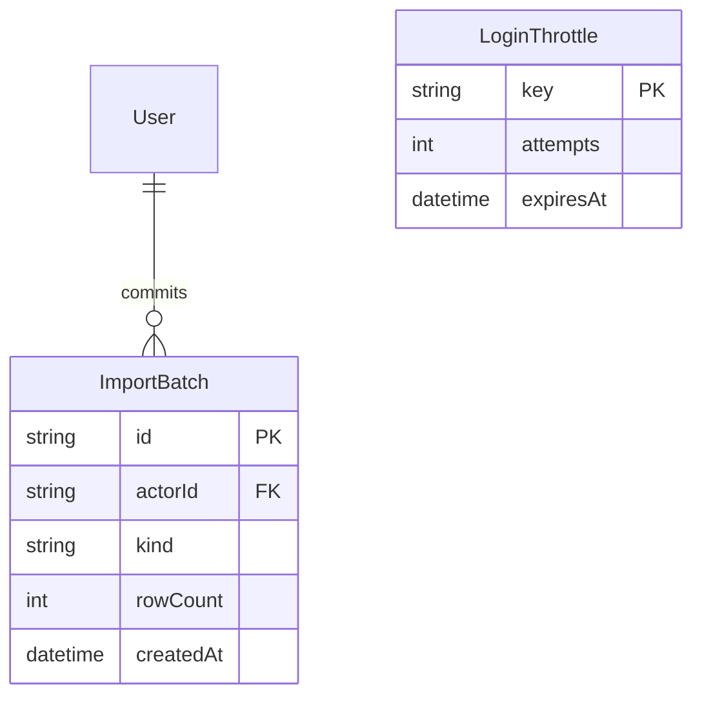

# Phase 5 – Reporting, Excel và production readiness

## Kiến trúc và kế hoạch

Giữ modular monolith. Bổ sung `/reports`, `/audit`, API reporting/import và health. `excel` xử lý XLSX ở server; `import-service` kiểm tra tham chiếu, bản xem trước ký số và transaction; `reporting` dùng capacity/forecast engine đã kiểm thử. Không tạo nguồn tính MM thứ hai. Thứ tự: thiết kế → workbook/validation/import → báo cáo/audit → hardening/runbook → unit/integration/build/HTTP và kiểm tra browser nếu khả dụng.

## Import và export

Hỗ trợ XLSX cho Employee, Project, Planned và Actual, mỗi file một loại. Template có sheet Data với header ổn định, sheet hướng dẫn tiếng Việt. Dùng employeeCode/projectCode/pmCode để tham chiếu; giữ số, MM và ngày có kiểu. Không import user/password, lịch nghỉ riêng tư, xóa bản ghi hoặc thay đổi demand/kỹ năng qua một template không đủ ngữ nghĩa. Demand/kỹ năng vẫn quản lý ở module chuyên biệt; export báo cáo forecast riêng.

Giới hạn file nén 2 MiB, giải nén 16 MiB, 128 entry, tối đa 200 dòng, 20 cột; chỉ XLSX, không macro, external links, embedded objects, formula hoặc hyperlink. Kiểm tra kích thước thực khi giải nén trước khi parser đọc. Từ chối header lạ/thiếu/trùng và khóa tự nhiên trùng trong file. MM không âm, tối đa 4 số; ô thiếu không được ép thành 0. Allocation quá capacity được phép với cảnh báo, không sửa capacity.

Preview không ghi dữ liệu. Server chuẩn hóa, kiểm tra tất cả dòng, trả lỗi theo dòng và ký payload có actor, fingerprint trạng thái dữ liệu/tham chiếu, thời hạn 10 phút và batch ID. Commit chỉ nhận token, xác minh actor/chữ ký/thời hạn và đọc lại dữ liệu trong transaction Serializable. Thay đổi từ lúc preview trả 409, cần xem trước lại. Toàn file và audit từng dòng/batch ghi cùng transaction; lỗi bất kỳ rollback. Batch ID unique cho retry idempotent, không lưu file hoặc token vào database/log. Không tự retry xung đột bằng dữ liệu cũ. Mã nhân viên/dự án là khóa upsert; đổi mã phải qua module chuyên biệt.

## ERD bổ sung

User thêm sessionVersion để thu hồi toàn bộ phiên; audit thêm index thời gian/actor phục vụ phân trang. Không lưu tổng capacity/demand vào database. Báo cáo XLSX là snapshot thời điểm xuất, thiếu capacity/demand giữ trống kèm trạng thái, không thay bằng 0.

## Quyền và vận hành

ADMIN/MANAGER import; VIEWER xem và export báo cáo nghiệp vụ. Audit chỉ ADMIN/MANAGER, có filter actor/entity/action/ngày và phân trang, payload nhạy cảm bị lọc phòng vệ. Không có API sửa/xóa audit. Giữ append-only trigger hiện có.

Production readiness gồm security headers, no-store API, health liveness/readiness tối giản, login throttle trong PostgreSQL dùng chung nhiều process, sessionVersion và lệnh thu hồi phiên, script kiểm tra cấu hình production, Docker/CI và runbook migrate/backup/restore/rollback/monitoring. Không tự deploy hoặc thay secret/tài khoản đang dùng. Không coi checklist hoặc build thành công là chứng nhận production: browser E2E, diễn tập restore và cấu hình hạ tầng phải có bằng chứng riêng.
